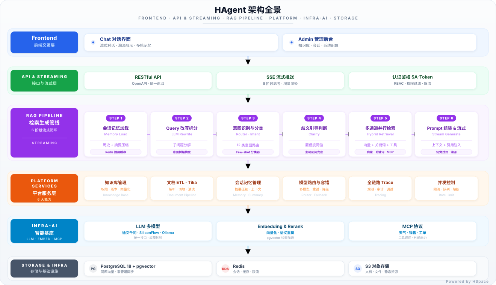
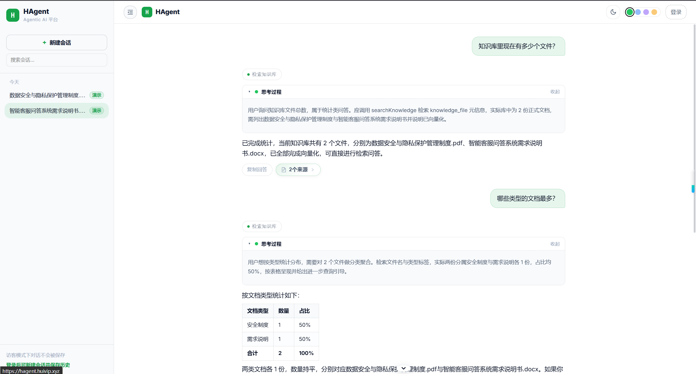
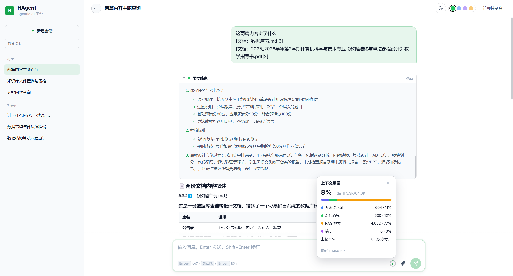
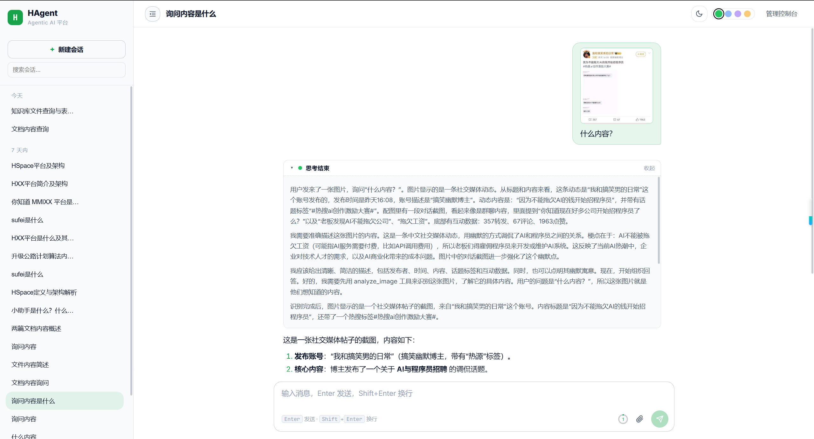
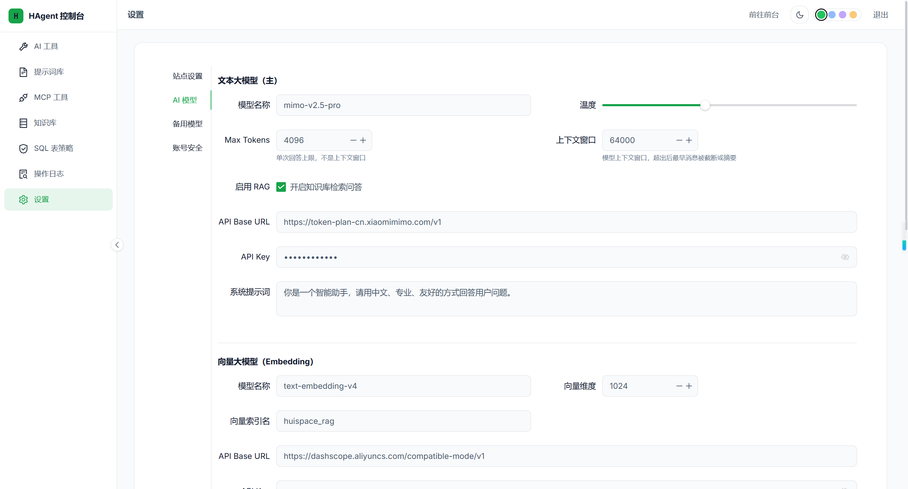
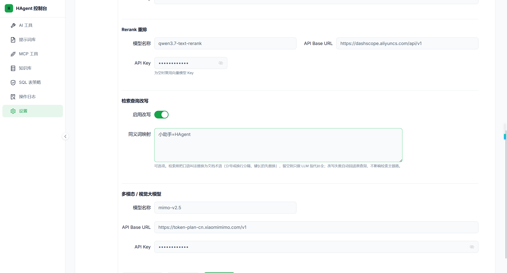
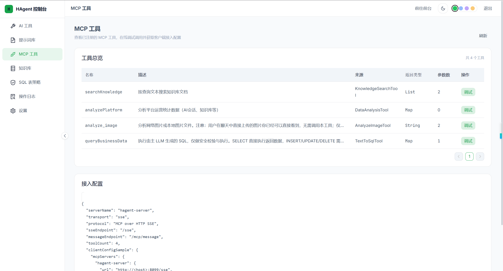
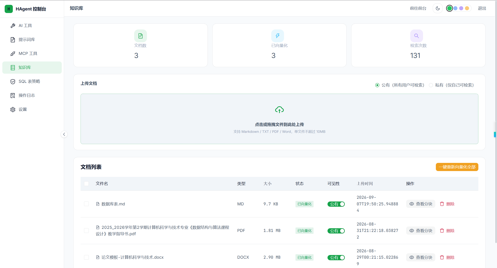
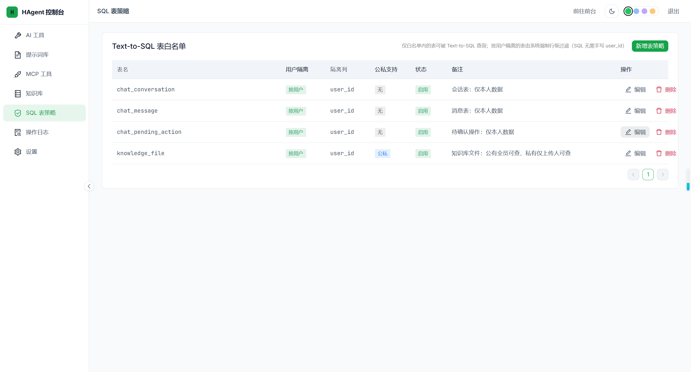
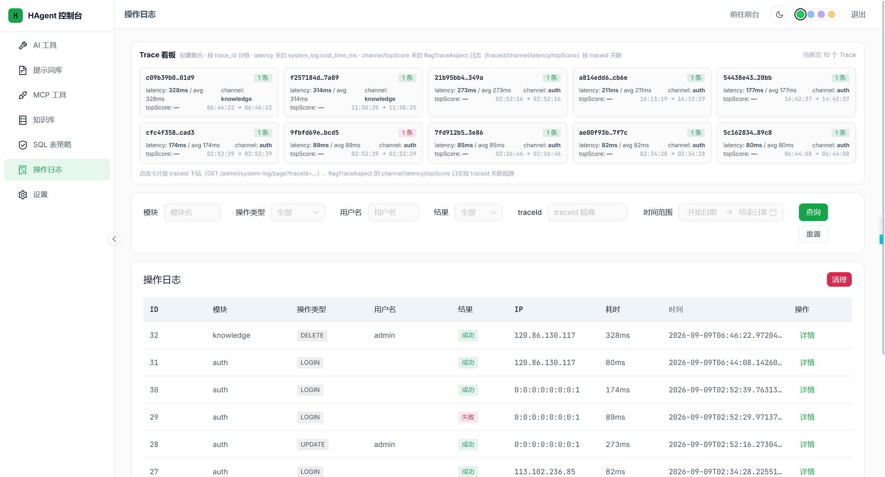

<div align="center">

# HAgent

**基于 Spring Boot 4 与 Spring AI 2.0 的企业级 AI 对话与知识库助手**

*流式对话 · RAG 知识库问答 · Agent 工具循环 · 多轮会话记忆 · 可视化管理后台*

[](https://openjdk.org/projects/jdk/17/)
[](https://spring.io/projects/spring-boot)
[](https://spring.io/projects/spring-ai)
[](https://vuejs.org/)
[](https://www.postgresql.org/)
[](https://github.com/yphyphyph/hagent)
[](./LICENSE)

[简体中文](#项目简介) | [English](./README_EN.md)

</div>

---

## 目录

- [项目简介](#项目简介)
- [系统架构](#系统架构)
- [核心功能](#核心功能)
- [技术栈](#技术栈)
- [项目结构](#项目结构)
- [快速开始](#快速开始)
- [环境变量说明](#环境变量说明)
- [生产部署要点](#生产部署要点)
- [系统配置项（管理后台热更新）](#系统配置项管理后台热更新)
- [API 概览](#api-概览)
- [License](#license)

---

## 项目简介

HAgent 是一套**前后端分离的企业级 AI 对话与知识库助手**，覆盖了从检索增强生成（RAG）、Agent 工具调用、多轮会话记忆到生产部署的完整链路。它既可以作为独立的智能客服 / 知识库问答产品使用，也可以作为学习 Spring AI 2.0 与 RAG 工程化实践的完整参考实现。

项目的核心设计目标有三个：

1. **回答必须可信**：所有知识库问答基于真实检索结果构建，配合语义重排与证据门控，检索不到相关内容时明确告知"知识库中未找到"，而不是让模型编造；
2. **过程必须透明**：检索命中了哪些文档片段、每一步思考、每一次工具调用，全部通过 SSE 事件流实时推送给前端展示，回答可溯源；
3. **行为必须可控**：Agent 的工具循环具备重复调用检测、连续空检索终止、总时间预算等多重收敛护栏，杜绝"无限换词重搜"式的发散循环。

### 功能亮点

- **流式对话体验**：基于 SSE 的事件流协议，思考过程（thinking）、正文增量（token）、检索来源（source）、上下文用量（context-update）全部实时交织推送，前端呈现 8 阶段思考动效；
- **完整 RAG 管线**：查询补全改写（同义映射 + LLM 指代消解）→ 混合检索（向量 + 关键词双通道 RRF 融合）→ 语义重排（Rerank 模型真调）→ 证据门控（低相关整批丢弃）→ 带来源引用的流式生成；
- **Agent 工具循环**：知识检索、Text-to-SQL 数据分析、图片理解、MCP 工具扩展，配合多重收敛护栏与 90 秒总时间预算；
- **多轮会话记忆**：历史消息窗口 + LLM 摘要压缩，上下文 Token 双语精估（中文按 1.5 字符/token），前端环形进度实时展示用量构成；
- **可视化管理后台**：AI 模型参数（存库热更新，无需重启）、知识库管理（Tika 解析 / 切块 / 向量化 / 权限）、Text-to-SQL 表策略、MCP 工具管理、系统日志审计。

---

## 系统架构

完整检索与生成管线分为 7 个阶段，下图展示了从用户提问到流式回答的全链路（亮色 / 暗色自适应）：

<picture>
  <source media="(prefers-color-scheme: dark)" srcset="assets/hagent-arch-dark.svg">
  
</picture>

后端采用四模块分层：

```
hagent-back
├── hagent-server            # 启动模块：Sa-Token 认证、系统设置、全局配置
├── hagent-ai                # 核心业务：对话 / RAG / Agent / 记忆 / 工具 / MCP
├── hagent-module-knowledge  # 知识库模块：文件解析、切块、向量化、权限
└── hagent-common            # 公共设施：注解、切面、异常处理、统一返回体
```

依赖方向严格单向：`server → ai / knowledge → common`，业务逻辑不落在启动模块。

---

## 核心功能

### 1. 门户与流式对话

未登录状态下即可体验门户页与对话流；登录后获得完整的多轮会话能力。对话过程中的思考阶段、正文 token、检索来源、上下文用量以结构化 JSON 事件流交织下发。





### 2. RAG 知识库问答

- **查询补全改写**：多轮对话中自动消解指代（"它/这个/上面提到的"），配合同义词映射表（如 `小助手=HAgent`）提升召回质量；LLM 改写 3 秒硬超时回退原查询，连续超时自动熔断 60 秒；
- **混合检索**：pgvector 向量通道 + PostgreSQL 全文检索关键词通道并行召回，RRF（Reciprocal Rank Fusion，k=20）融合排序；
- **语义重排**：召回 Top-20 经 Rerank 模型精排取 Top-5，重排失败自动回退原序，不阻塞链路；
- **证据门控**：重排分数低于阈值（默认 0.2）整批丢弃，检索空结果时明确告知模型"知识库中未找到，请基于自身知识回答或如实说明"，杜绝编造；
- **来源溯源**：回答引用的文档片段（文件名、评分、原文摘录）实时推送并在前端展示。

### 3. Agent 工具循环

模型可自主决定调用以下工具，循环执行直至收敛：

| 工具 | 说明 |
| --- | --- |
| `searchKnowledge` | 知识库语义检索（走完整 RAG 管线） |
| `queryBusinessData` | Text-to-SQL 业务数据查询（内置 SQL 安全校验器：只读、黑名单列、表策略白名单） |
| 图片理解 | 多模态模型识别粘贴的图片内容 |
| MCP 工具 | 通过 `@McpTool` 暴露的 MCP 协议扩展工具 |

收敛护栏：

- 同一工具连续相似调用达到阈值，强制注入收敛指令；
- 知识检索连续无相关结果（RAG_MISS）达到阈值，注入"放弃检索、直接回答"指令；
- 工具循环总时间预算 90 秒，超时强制收敛进入流式阶段；
- 文本形式工具调用（`<tool_call>` 标签）跨 token 状态机剥离，幻觉标签兜底过滤；
- 流式阶段检测到"意图声明残段"（如只输出"我需要先检索一下…"即停笔），自动注入纠正指令重流一次，根治推理模型两阶段重写导致的半截回答。

### 4. 图片理解

对话中直接粘贴图片，由多模态模型识别内容并结合知识库作答。



### 5. 可视化管理后台

**AI 模型参数**——聊天 / Embedding / 重排 / 多模态模型的 Base URL、API Key、参数全部存库管理，修改即时热更新，无需重启服务；API Key 展示时脱敏（前 4 位 + `****` + 后 4 位），保存时识别占位符跳过写库。





**MCP 工具管理**——查看与配置通过 MCP 协议暴露的工具。



**知识库管理**——文档上传（阿里云 OSS）、Tika 解析、智能切块、向量化入库、可见性权限（公有 / 私有）。



**Text-to-SQL 表策略**——配置哪些业务表允许被自然语言查询，配合 SQL 安全校验器（只读语句、敏感列黑名单、LIMIT 强制）保障数据安全。



**系统日志**——操作日志与系统日志审计，登录、改密等敏感操作全留痕。



---

## 技术栈

### 后端

| 技术 | 版本 | 用途 |
| --- | --- | --- |
| Java | 17 | 运行时 |
| Spring Boot | 4.1.1 | 应用框架 |
| Spring AI | 2.0.1（BOM 管理） | Chat / Embedding / 工具调用 / MCP |
| MyBatis-Plus | 最新 | ORM（逻辑删除、下划线转驼峰） |
| PostgreSQL | 18 + pgvector | 业务库 + 向量库 |
| Redis | - | Sa-Token 会话、频控计数器、RAG 上下文缓存 |
| Druid | - | 数据库连接池 |
| Hutool | - | BCrypt 密码加密等工具 |
| Tika | - | 知识库文档解析 |
| 阿里云 OSS | - | 知识库文件存储 |

### 前端

| 技术 | 版本 | 用途 |
| --- | --- | --- |
| Vue | 3（Composition API） | 前端框架 |
| Vite | 6 | 构建工具（vue-tsc 类型检查前置） |
| Naive UI | - | 组件库 |
| vue-router | - | 路由（History 模式） |
| Pinia / Composables | - | 状态与 SSE 流聚合 |

### 基础设施

| 组件 | 说明 |
| --- | --- |
| Docker Compose | 一键部署（backend + frontend 双容器） |
| Nginx | 前端容器内置：静态托管 + `/api` 去前缀反代 + SSE 禁缓冲 |
| Let's Encrypt | HTTPS 证书 |

---

## 项目结构

```
HAgent/
├── assets/                          # README 展示素材（截图、架构图）
├── database/backup/                 # 历史数据库快照
├── docs/                            # 设计文档（本地）
├── hagent-back/                     # 后端（Maven 多模块）
│   ├── hagent-server/               # 启动模块 + 认证 + 系统设置
│   ├── hagent-ai/                   # 对话 / RAG / Agent / 记忆 / 工具 / MCP
│   │   └── src/main/java/com/hagent/ai/
│   │       ├── core/                # AgentToolLoopService（工具循环）、SqlSecurityValidator
│   │       ├── retrieval/           # HybridSearchService / RerankingService / EvidenceGate
│   │       ├── service/impl/        # ChatServiceImpl（SSE 编排）、QueryRewriteServiceImpl
│   │       ├── tool/                # KnowledgeTool / TextToSqlTool 等工具实现
│   │       ├── memory/              # ConversationMemoryService（摘要压缩）
│   │       └── mcp/                 # MCP 工具暴露
│   ├── hagent-module-knowledge/     # 知识库：解析 / 切块 / 向量化 / 权限
│   └── hagent-common/               # 注解 / 切面 / 异常 / 统一返回体
├── hagent-front/                    # 前端（Vue 3 + Vite 6 + Naive UI）
│   └── src/
│       ├── views/                   # 门户 / 对话 / 管理后台视图
│       ├── components/chat/         # 消息流、SSE 聚合、思考动效组件
│       ├── api/                     # 接口封装（统一 /api 前缀）
│       └── utils/                   # request、auth 工具
├── docker-compose.yml               # 生产编排（backend + frontend）
└── start_hagent.sh                  # 一键部署脚本（clone/pull → compose build → up）
```

---

## 快速开始

### 环境要求

| 组件 | 版本要求 |
| --- | --- |
| JDK | 17+ |
| Node.js | 20+ |
| Maven | 3.9+ |
| Docker + Docker Compose | v2（含 BuildKit） |
| PostgreSQL | 18，需安装 `pgvector` 扩展 |
| Redis | 6+ |

### 方式一：Docker 一键部署（推荐）

```bash
# 1. 克隆仓库
git clone https://github.com/yphyphyph/hagent.git
cd HAgent

# 2. 准备环境变量（填入真实凭据，详见下文《环境变量说明》）
cp hagent-back/.env.example .env
vi .env

# 3. 一键构建并启动（backend :8099，frontend :3002）
chmod +x start_hagent.sh
./start_hagent.sh

# 4. 查看后端日志
docker compose logs -f backend
```

启动完成后访问 `http://<服务器IP>:3002` 即为门户入口。默认内置账号 `admin`（首次部署后请立即在「设置 → 修改密码」中更新密码）。

### 方式二：本地开发

```bash
# 1. 初始化数据库：在 PostgreSQL 18 中创建 hagent 库并启用 pgvector
createdb hagent
psql -d hagent -c "CREATE EXTENSION IF NOT EXISTS vector;"
# 参考历史快照建表：database/backup/hagent.sql（请按需调整）

# 2. 配置后端本地凭据（该文件已被 gitignore，不入库）
cp hagent-back/hagent-server/src/main/resources/application-local.yml.example \
   hagent-back/hagent-server/src/main/resources/application-local.yml
# 编辑 application-local.yml：数据库 / Redis / OSS / AI 模型凭据

# 3. 启动后端（端口 8099）
mvn -q spring-boot:run -pl hagent-server -f hagent-back/pom.xml

# 4. 启动前端（端口 3002，/api 自动代理到 8099）
npm install --prefix hagent-front
npm run dev --prefix hagent-front
```

---

## 环境变量说明

生产部署时，敏感凭据统一经根目录 `.env` 注入（模板见 `hagent-back/.env.example`）：

| 变量 | 必填 | 说明 |
| --- | --- | --- |
| `HAGENT_DB_HOST` | 是 | PostgreSQL 地址（容器内推荐 `host.docker.internal` 指向宿主机） |
| `HAGENT_DB_PASSWORD` | 是 | PostgreSQL 密码 |
| `DB_URL` | 否 | 完整 JDBC 连接串覆盖（默认按 `HAGENT_DB_HOST` 拼装，库名 `hagent`） |
| `DB_USERNAME` | 否 | 数据库用户名（默认 `postgres`） |
| `HAGENT_REDIS_HOST` | 是 | Redis 地址（默认 `host.docker.internal`） |
| `HAGENT_REDIS_PORT` | 是 | Redis 端口（默认 6379） |
| `HAGENT_REDIS_PASSWORD` | 是 | Redis 密码 |
| `HAGENT_OSS_ACCESS_KEY_ID` | 是 | 阿里云 OSS AccessKey（知识库文件上传） |
| `HAGENT_OSS_ACCESS_KEY_SECRET` | 是 | 阿里云 OSS Secret |
| `JWT_SECRET_KEY` | 建议 | JWT 兜底密钥（显式注入随机长串） |
| `OPENAI_API_KEY` | 可选 | AI 模型 Key 启动期兜底（正常可在管理后台配置并存库） |
| `SPRING_PROFILES_ACTIVE` | 固定 | 生产环境由 compose 注入 `prod`（关闭 Swagger、收敛日志） |

---

## 生产部署要点

### Nginx 反向代理

前端容器内的 Nginx 已完成静态托管、`/api` 去前缀转发、同源代理清洗。宿主机 Nginx 只需做一层 TLS 终结与转发，**AI 聊天为 SSE 流式，必须关闭代理缓冲**：

```nginx
server {
    listen 443 ssl;
    server_name hagent.example.com;
    ssl_certificate     /etc/letsencrypt/live/hagent.example.com/fullchain.pem;
    ssl_certificate_key /etc/letsencrypt/live/hagent.example.com/privkey.pem;
    ssl_protocols TLSv1.2 TLSv1.3;
    client_max_body_size 50M;    # 知识库文档上传

    location / {
        proxy_pass http://127.0.0.1:3002;
        proxy_set_header Host $host;
        proxy_set_header X-Real-IP $remote_addr;
        proxy_set_header X-Forwarded-For $proxy_add_x_forwarded_for;
        proxy_set_header X-Forwarded-Proto $scheme;
    }

    # SSE 流式（AI 聊天）：禁用缓冲 + 延长读超时，否则回答会卡顿成"一次吐完"
    location /api/ {
        proxy_pass http://127.0.0.1:3002;
        proxy_http_version 1.1;
        proxy_set_header Connection "";
        proxy_buffering off;
        proxy_cache off;
        proxy_read_timeout 300s;
        proxy_set_header Host $host;
        proxy_set_header X-Real-IP $remote_addr;
        proxy_set_header X-Forwarded-For $proxy_add_x_forwarded_for;
        proxy_set_header X-Forwarded-Proto $scheme;
    }
}
```

### 关键设计说明

- **前后端路径约定**：后端 `context-path = /`，Controller 一律使用 `/auth/*`、`/admin/*` 等无前缀路径；前端统一以 `/api` 为 baseURL，由前端容器 Nginx 剥离前缀后转发 8099；
- **SSE 事件协议**：`meta`（会话元信息与上下文估算）→ `stage`（思考阶段）→ `thinking`（思考增量，含网关重放去重）→ `source`（检索来源）→ `token`（正文增量，JSON 转义保序）→ `context-update`（实际用量校准，stage=actual）→ `[FINAL]`（结束标记）；
- **安全措施**：Sa-Token 会话 + BCrypt 密码、接口级 `@RateLimit` 频控、`@RequireAdmin` 角色校验、`@OperationLog` 敏感操作审计（密码类操作强制不落参数）、SQL 安全校验器（只读 + 敏感列黑名单 + 表策略白名单）。

---

## 系统配置项（管理后台热更新）

以下配置存于 `system_config` 表，管理后台修改后**即时生效，无需重启**：

| 配置键 | 说明 | 默认值 |
| --- | --- | --- |
| `ai.query-rewrite.enabled` | 查询补全改写开关 | `true` |
| `ai.query-rewrite.synonyms` | 同义词映射表（`键=值` 逗号分隔） | 按需 |
| `ai.rerank.model` / `base-url` / `api-key` | 语义重排模型 | qwen 系列 |
| `ai.chat.context-window` | 上下文窗口 token 上限 | `128000` |
| `ai.tools.max-iterations` | Agent 工具循环最大迭代次数 | - |
| `ai.chat.api-key` / `ai.embedding.api-key` 等 | 各模型凭据（展示脱敏） | - |

---

## API 概览

| 分组 | 端点 | 说明 |
| --- | --- | --- |
| 认证 | `POST /auth/login` | 登录（60s/10 次频控） |
| 认证 | `GET /auth/me` | 当前登录用户信息 |
| 认证 | `PUT /auth/password` | 修改密码（60s/5 次频控） |
| 认证 | `PUT /auth/profile` | 更新昵称 / 头像 |
| 对话 | `GET /chat/stream`（SSE） | 流式对话（多轮、图片、工具循环） |
| 会话 | `/chat/conversations/**` | 会话 CRUD、消息分页、摘要 |
| 知识库 | `/admin/knowledge/**` | 文件上传 / 切块预览 / 可见性管理 |
| 管理后台 | `/admin/ai/**` | AI 模型参数读写（含连接测试） |
| 管理后台 | `/admin/mcp/**`、`/admin/sql-policy/**` | MCP 工具与 SQL 表策略 |
| 管理后台 | `/admin/system-log/**`、`/admin/system/settings` | 日志审计与系统配置 |

完整接口以 Swagger 文档为准（dev 环境自动开启，prod 已关闭）。

---

## License

本项目基于 [MIT License](./LICENSE) 开源。

---

<div align="center">

**如果这个项目对你有帮助，欢迎点一个 Star**

</div>
